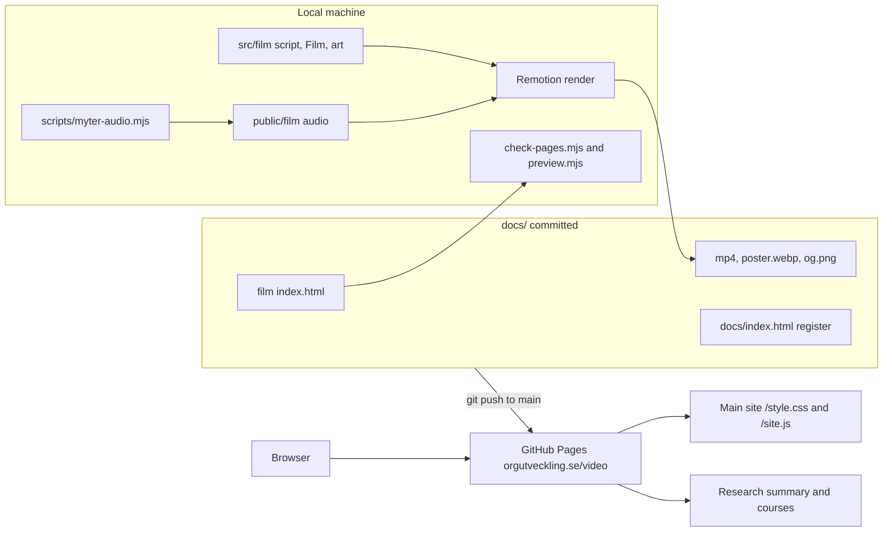

# Video

Short films for Centrum för Organisationsutveckling, made in code, and the pages they are shared from. Live at `https://orgutveckling.se/video/`.

## What it is

- One Remotion project (React, each frame is a pure function of the frame number) that renders every film.
- One static page per film under `docs/`, served by GitHub Pages from `main` `/docs`. The repo is a project site under the `elwyndaz.github.io` user site, which is why it lands on `orgutveckling.se/video/`.
- Purpose of each page: let someone watch the film from a link, then click on to the research summary (`/forskning/`) and to the courses (`/utbildningar.html`).

## Layout

| Path | Content |
|---|---|
| `src/Root.tsx` | One `Composition` per film |
| `src/<film>/` | The film: `script.ts` (all text), `Film.tsx` (timing, layout), `art.ts` (drawing) |
| `scripts/<film>-audio.mjs` | Synthesises music and cues into `public/<film>/` (gitignored, rebuilt by `npm run prep`) |
| `docs/<film>/` | `index.html`, the rendered `mp4`, `poster.webp` (the page's poster, preloaded: it is the LCP; `poster.jpg` is the older copy), `og.png`. Committed: this is what is served |
| `docs/index.html` | Register of all films |
| `docs/404.html` | Copy of the main site's `404.html`: Pages serves it for any missing path under `/video/` (without it, GitHub's English page). Copy it again when the main site's one changes; `check:pages` fails on chrome drift |
| `docs/video.css` | Only what the film pages add to the main site's design system |
| `scripts/preview.mjs`, `scripts/check-pages.mjs` | Local preview with the production CSP, and the page check |
| `scripts/*.test.mjs` | `npm test`: invariants for `art.ts` and the text timing in `Film.tsx`, the preview server (paths, CSP, byte ranges), and the synthesised wav files (format, length, the holes where the stamps land) |

## Architecture

Films are rendered locally and committed; GitHub Pages serves `docs/` as it is.

## Stack

- Films: Remotion 4 with React 19, rendered to self-hosted mp4
- Pages: static HTML in `docs/`, borrowing the main site's CSS and JS by absolute path
- Code: TypeScript, Node scripts for audio, preview and page check
- Tests: `npm run check` (`tsc`), `npm test` (Node test runner, no dependencies) and `npm run check:pages` with Playwright
- Hosting: GitHub Pages from `main` `/docs`, orgutveckling.se/video

## Conventions

- **The pages borrow the main site.** `/style.css`, `/site.js`, fonts, header, footer and the closing "Begär förslag" band come from `elwyndaz.github.io` by absolute path on the same domain. Design rules live in that repo's `CONTEXT.md` and are not repeated here. Header, nav and footer markup is copied, so a nav change there must be copied here: `check:pages` fails when the links in header, menus or footer differ from the main site's `/`.
- **CSP is set on the Cloudflare zone**, not here: `default-src 'self'`, no external embeds. Video is self-hosted for that reason. No YouTube or Vimeo iframes, no inline scripts.
- **Film pages are `noindex, follow`.** They are landing pages for shared links, not search content, and are not in the main site's sitemap.
- **URLs are folders** (`/video/myter/`), never renamed after sharing: GitHub Pages cannot redirect.
- **Films are readable without sound.** All dialogue is on-screen text; music and cues are decoration.
- **Every claim in a film is a claim in the research summary** (`C:\dev\forskning`), worded no stronger than it is there.
- Swedish text: no em-dash, decimal comma, space as thousands separator.

## Films

| Film | Composition | Length | Format |
|---|---|---|---|
| `myter` | `Myter` | 81,6 s (2448 frames at 30 fps) | 1080×1080, 150 BPM grid: 1 bar = 48 frames |

`myter`: pixel art drawn procedurally as rects on a logical grid (135 px square shown, 8 screen px per logical px), one SVG with `viewBox` as camera. Characters Liv, Nadja, Göran and Mira come from the game Kontoret, but the film does not link to the game.

## Audits
- Secrets: 2026-10-30, pass, gitleaks 0 findings in 10 commits
- Actions: 2026-10-30, n/a, no GitHub Actions workflows
- npm audit: 2026-11-24, pass, 0 vulnerabilities in production and dev (after remotion 4.0.544, 2026-11-17)
- Dependabot: 2026-11-24, pass, 0 open alerts
- Headers (automated): 2026-10-30, pass, 6 of 6 on orgutveckling.se/video, Observatory A+ on orgutveckling.se
- WCAG 2.2 AA (automated): 2026-11-25, needs-review, axe 0 violations (WCAG 2.2 AA plus best-practice) on live /video/, /video/myter/ and the 404 page at 390 and 1440 px; check-pages 12 of 12; manual keyboard pass not done
- Speed: 2026-11-25, pass, live at 390 px, Slow 4G, CPU 4x: LCP /video/ 1640 ms, /video/myter/ 1900 ms (4436 before the WebP poster), 404 page 1644 ms; at 1440 about 200 ms; CLS at most 0,0041; /video/myter/ transfers 276 kB (404 before) plus the mp4 on play
- UX: 2026-11-24, warn, 4 of 6 script checks pass on live orgutveckling.se/video/ and /video/myter/ (local preview gave the same; no forms so no --interact): warn Fitts targets and Von Restorff primary, both in header, footer and request band copied from the main site; screenshot review at 390 and 1440 found nothing page-specific (2026-10-30: warn, 4 of 6, review not done)
- OWASP Top 10: 2026-10-30, pass, code review (Mistral Large; Claude read only the verdict line, lows unread), no live probe; 0 high, 0 medium reported
- Mutation: 2026-11-24, Stryker scripts/preview.mjs 100 % (87 of 87; no tests before), scripts/myter-audio.mjs 64,45 % (50,29 % with its first tests; no tests before), 123 survivors reviewed: which bar kind plays which instrument, volumes and the noise generator, only an ear can judge. src/myter/art.ts 56,06 % (2026-11-04, not re-measured), 312 survivors: pixel coordinates, colours and per-character details only a still can judge

## Compute
Vart ledig kvot kan gå. Läses av fliken Compute i elwyn-dash och `tools/compute-queue.mjs` i aifabriken.

- Skapa: oändlig, fler kortfilmer för orgutveckling.se/video/
